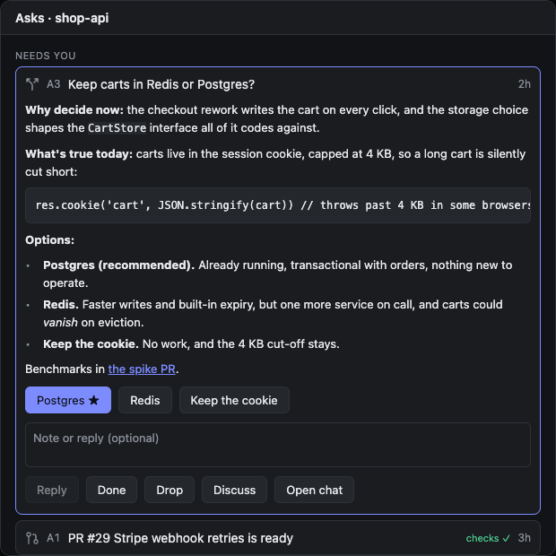
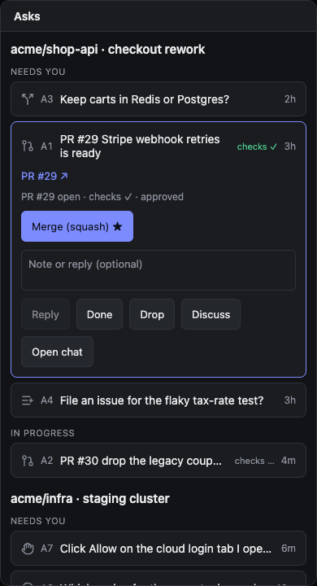

# Asks for Paseo

Asks is a [Paseo](https://paseo.sh) plugin. It lifts what your agents need from you out of their chats and into one list. When an agent needs a PR reviewed, a decision made, a follow-up approved or a manual step done, it records an **ask**. Each ask carries the buttons that answer it, and pressing one sends the answer back to the agent that raised it.

| Workspace panel, a decision with a markdown brief | Every workspace, on a phone, a PR ask expanded |
|---|---|
|  |  |

<sub>The screenshots render the plugin's own React Native components with sample data, using react-native-web (`preview/`). Inside Paseo they sit in its panel and screen chrome.</sub>

## What you can do with an ask

- **Pick an option.** A decision's options are buttons, and the agent's recommendation is starred. The agent gets `[asks] A3 resolved: b: squash-only`.
- **Hand work back.** A PR or follow-up offers actions such as "Merge (squash)". Pressing one sends the agent that exact instruction and shows the ask as *in progress* until the agent closes it.
- **Reply, mark done, or drop.** A note can go along with any of these.
- **Discuss.** Opens a side chat about this one ask. It's a child of the main agent, starts read-only (plan mode), and already knows the ask and the main agent's latest reply. Talk it through there. When you settle it, the side chat closes the ask, and the main agent gets the outcome as one message: `[asks] A3 resolved in a side chat: … Summary: …`. Only the main agent ever changes the checkout.
- **Open chat.** Jumps to the agent that raised the ask.

PR asks show live status from `gh`: open, merged or closed, checks, review decision and conflicts. An agent that subscribed to a PR ask is told when it merges, closes, its checks pass or fail, or its review decision changes.

## Where asks show up

- an **Asks** panel in each workspace (also in ⌘K: "Open asks for this workspace");
- an **Asks** screen in the sidebar, covering every workspace, with a count of what's waiting;
- an **Asks · n** (or **No asks**) pill in every agent's composer. Pressing it lists that agent's asks, with a **Refresh asks** button that tells the agent to bring them up to date: create asks it skipped, and update or resolve stale ones.

## How it works

```
agent ──stdio MCP──▶ bridge.mjs ──HTTP 127.0.0.1──▶ plugin server ──▶ ~/.paseo/plugin-data/asks/
  ▲                    (inherits PASEO_AGENT_ID,                  │  workspaces/<id>.json, outbox.json
  │                     so every call knows its caller)           │
  └──── "[asks] …" message, held until the agent's turn ends ─────┘
```

- Every agent created after the plugin is installed gets an `asks` MCP server with `ask_create`, `ask_update`, `ask_resolve` and `ask_list`. Its instructions tell the agent when to use them, so no `CLAUDE.md` edit is needed.
- Agents sometimes ask in chat and skip `ask_create`. When a turn ends on a question, uses no asks tool and names no ask id, the plugin sends one `[asks]` reminder. Its answer is never reminded again, and side chats are never reminded.
- Answers are written to an on-disk outbox first. They're sent only when the agent is between turns, because a prompt sent mid-turn interrupts it, and several answers are batched into one message. A plugin restart loses nothing.
- If the agent that raised an ask is archived, the ask is marked *orphaned*: you can still close it, and nobody is notified.

## Install

Paseo 0.12 or newer, with plugins enabled on the daemon. `gh`, if installed in `/opt/homebrew/bin`, `/usr/local/bin` or `/usr/bin`, adds live PR status.

```bash
git clone git@github.com:fullstackhouse/paseo-asks.git
cd paseo-asks && npm install
paseo plugin install "$PWD"
paseo plugin ls            # paseo-asks should be "running"
```

Agents that already exist don't get the tools. Start a new agent.

## From a terminal

The plugin writes the port and token of its local listener to `~/.paseo/plugin-data/asks/server.json`, so scripts can do what the UI does:

```bash
S=~/.paseo/plugin-data/asks/server.json
P=$(jq -r .port $S); T=$(jq -r .token $S)
curl -s -H "authorization: Bearer $T" -X POST localhost:$P/act \
  -d '{"workspaceId":"wks_…","id":"A3","verb":"action","actionId":"a2"}'
curl -s -H "authorization: Bearer $T" -X POST localhost:$P/discuss -d '{"workspaceId":"wks_…","id":"A3"}'
```

## Develop

```bash
npm run typecheck      # client and server tsconfigs
npm test               # vitest: store, outbox, tools, side chats, PR watching
paseo plugin reload paseo-asks && paseo plugin logs paseo-asks
cd preview && npm install && npm run dev   # the UI with sample data, at localhost:5199
```


## Design decisions

- **Agents report asks themselves.** Nothing reads transcripts to find them: only the agent knows what it is waiting on.
- **Four fixed action kinds** (`send`, `resolve`, `open`, plus the built-in Discuss). Agents supply labels and prompts, never arbitrary behaviour.
- **One writer per checkout.** Work goes back to the main agent; side chats are read-only and end with an outcome on the ask.
- **Push, held until the turn ends.** Answers reach the agent as prompts, from a disk outbox, never mid-turn.
- **External events only if subscribed,** so polling `gh` never wakes an agent for nothing.

## Limits

- Lists refresh by polling (every 4 s, and every 8 s for pill counts). Paseo has no plugin channel for pushing updates to the app.
- Side chats need a provider with a read-only mode. Claude has `plan`; with any other provider, Discuss reports an error.
- It's unverified whether agents created before a daemon restart keep the tools after it.
