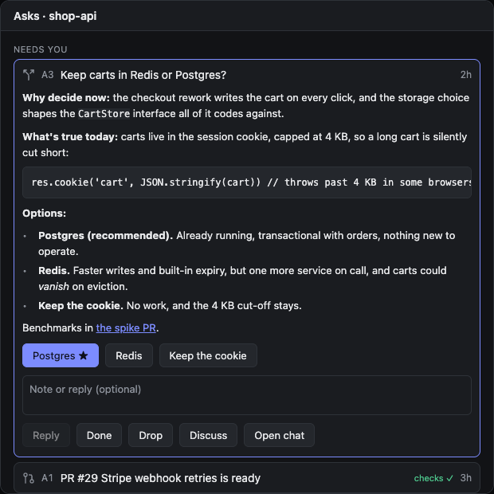
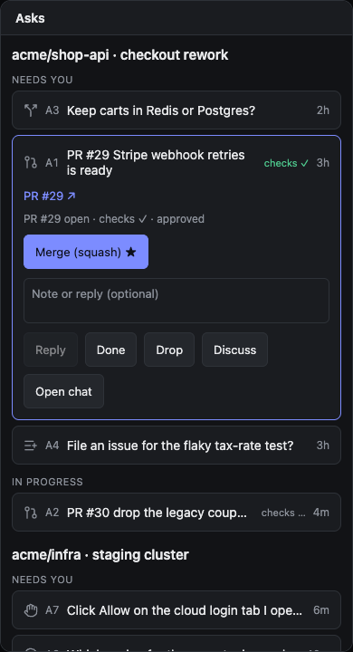
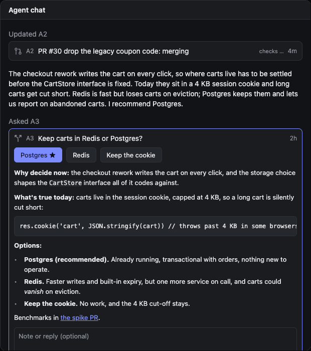

# Asks for Paseo

Asks is a [Paseo](https://paseo.sh) plugin. It lifts what your agents need from you out of their chats and into one list. When an agent needs a PR reviewed, a decision made, a follow-up approved or a manual step done, it records an **ask**. Each ask carries the buttons that answer it, and pressing one sends the answer back to the agent that raised it.

| Workspace panel, a decision with a markdown brief | Every workspace, on a phone, a PR ask expanded |
|---|---|
|  |  |



<sub>The screenshots render the plugin's own React Native components with sample data, using react-native-web (`preview/`). Inside Paseo they sit in its panel and screen chrome.</sub>

## What you can do with an ask

- **Pick an option.** A decision's options are buttons, and the agent's recommendation is starred. The agent gets `[asks] A3 resolved: b: squash-only`.
- **Hand work back.** A PR or follow-up offers actions such as "Merge (squash)". Pressing one sends the agent that exact instruction and shows the ask as *in progress* until the agent closes it. An in-progress ask hides its buttons, so it goes back to waiting on you when the agent gives it new actions, when the agent is archived, or after a day with the agent not running. An agent whose turn ends while it holds an in-progress ask gets one reminder to reopen it if the next move is yours.
- **Reply, mark done, or drop.** A note can go along with any of these.
- **Discuss.** Opens a side chat about this one ask. It's a child of the main agent, starts read-only (plan mode), and already knows the ask and the main agent's latest reply. Talk it through there. When you settle it, the side chat closes the ask, and the main agent gets the outcome as one message: `[asks] A3 resolved in a side chat: … Summary: …`. Only the main agent ever changes the checkout.
- **Open chat.** Jumps to the agent that raised the ask.
- **PR links open in the Inbox.** A GitHub PR link on an ask, and its PR status line, open that PR's review screen in [paseo-inbox](https://github.com/fullstackhouse/paseo-inbox), marked with an Inbox icon (hover says so on desktop); GitHub is a tap away from there. Without the Inbox, or on a host that can't open another plugin's screen (not the FSH build), they open GitHub. Links inside the ask's text still open GitHub.

PR asks show live status from `gh`: open, merged or closed, checks, review decision and conflicts. An agent that subscribed to a PR ask is told when it merges, closes, its checks pass or fail, or its review decision changes. While checks run, a PR ask can already carry a *Merge … when green* button: the agent merges once they pass, and fixes them first if they fail. To decide yourself when an agent works a review, turn off **Settings → Plugins → Asks → Tell agents about requested changes**: a reviewer requesting changes then raises an *Address review comments on PR #N* ask instead, and the agent starts only when you press its button. Agents are also told to leave requested changes to that ask; agents started or resumed before you change the setting keep the rules they started with.

## Where asks show up

- an **Asks** panel in each workspace, in the main area or the explorer (its **+** menu, or ⌘K: "Open asks for this workspace");
- an **Asks** screen in the sidebar, covering every workspace, with a count of what's waiting (asks in snoozed workspaces still list but leave the count);
- **inline in the agent's chat**, where it called `ask_create`, `ask_update` or `ask_resolve`: the tool row becomes the ask itself, live, open asks expanded with their buttons first, then the body (**Settings → Plugins → Asks** can fold the body behind a **Details** link). Agents are told to create the ask before their final reply, so the turn ends on their answer, which a collapsed turn keeps visible;
- a question-bubble pill in every agent's composer with the workspace's waiting count (0 when there are none). Pressing it lists the workspace's asks, that agent's first (others with **Open chat**), with a **Refresh asks** button that tells the agent to bring them up to date: create asks it skipped, and update or resolve stale ones.
- on FSH Paseo desktop, a workspace summary item per workspace (count, and whether asks wait on you). With the host setting **Entering a workspace opens the Explorer sidebar**, entering a workspace with a new waiting ask opens the Asks panel in Explorer. Hosts without `addWorkspaceSummaryItem` skip it.

## How it works

```
agent ──stdio MCP──▶ bridge.mjs ──HTTP 127.0.0.1──▶ plugin server ──▶ ~/.paseo/plugin-data/asks/
  ▲                    (inherits PASEO_AGENT_ID,                  │  workspaces/<id>.json, outbox.json
  │                     so every call knows its caller)           │
  └──── "[asks] …" message, held until the agent's turn ends ─────┘
```

- Every agent created after the plugin is installed gets an `asks` MCP server with `ask_create`, `ask_update`, `ask_resolve` and `ask_list`. Its instructions tell the agent when to use them, so no `CLAUDE.md` edit is needed.
- Agents sometimes ask in chat and skip `ask_create`. When a turn uses no asks tool and names no ask id, a short-lived child agent on the same provider (its cheapest model) judges whether the reply leaves anything for the human; if so, the plugin sends one `[asks]` reminder. If that check fails, a question mark in the last paragraph decides. Its answer is never reminded again, and side chats are never reminded.
- Answers are written to an on-disk outbox first. They're sent only when the agent is between turns, because a prompt sent mid-turn interrupts it, and several answers are batched into one message. A plugin restart loses nothing.
- If the agent that raised an ask is archived, the ask is marked *orphaned*: you can still close it, and nobody is notified.

## Install

Paseo 0.12 or newer, with plugins enabled on the daemon. `gh`, if installed in `/opt/homebrew/bin`, `/usr/local/bin` or `/usr/bin`, adds live PR status.

```bash
git clone git@github.com:fullstackhouse/paseo-asks.git
cd paseo-asks && npm install
paseo plugin install "$PWD"
paseo plugin ls            # paseo-asks should be "running"
```

Agents that already exist don't get the tools. Start a new agent.

## From a terminal

The plugin writes the port and token of its local listener to `~/.paseo/plugin-data/asks/server.json`, so scripts can do what the UI does:

```bash
S=~/.paseo/plugin-data/asks/server.json
P=$(jq -r .port $S); T=$(jq -r .token $S)
curl -s -H "authorization: Bearer $T" -X POST localhost:$P/act \
  -d '{"workspaceId":"wks_…","id":"A3","verb":"action","actionId":"a2"}'
curl -s -H "authorization: Bearer $T" -X POST localhost:$P/discuss -d '{"workspaceId":"wks_…","id":"A3"}'
```

## Develop

```bash
npm run typecheck      # client and server tsconfigs
npm test               # vitest: store, outbox, tools, side chats, PR watching
paseo plugin reload paseo-asks && paseo plugin logs paseo-asks
cd preview && npm install && npm run dev   # the UI with sample data, at localhost:5199
```


## Design decisions

- **Agents report asks themselves.** Nothing reads transcripts to find them: only the agent knows what it is waiting on.
- **Four fixed action kinds** (`send`, `resolve`, `open`, plus the built-in Discuss). Agents supply labels and prompts, never arbitrary behaviour.
- **One writer per checkout.** Work goes back to the main agent; side chats are read-only and end with an outcome on the ask.
- **Push, held until the turn ends.** Answers reach the agent as prompts, from a disk outbox, never mid-turn.
- **External events only if subscribed,** so polling `gh` never wakes an agent for nothing.

## Limits

- Lists refresh by polling (every 4 s, and every 8 s for pill counts). Paseo has no plugin channel for pushing updates to the app.
- Side chats need a provider with a read-only mode. Claude has `plan`; with any other provider, Discuss reports an error.
- It's unverified whether agents created before a daemon restart keep the tools after it.
