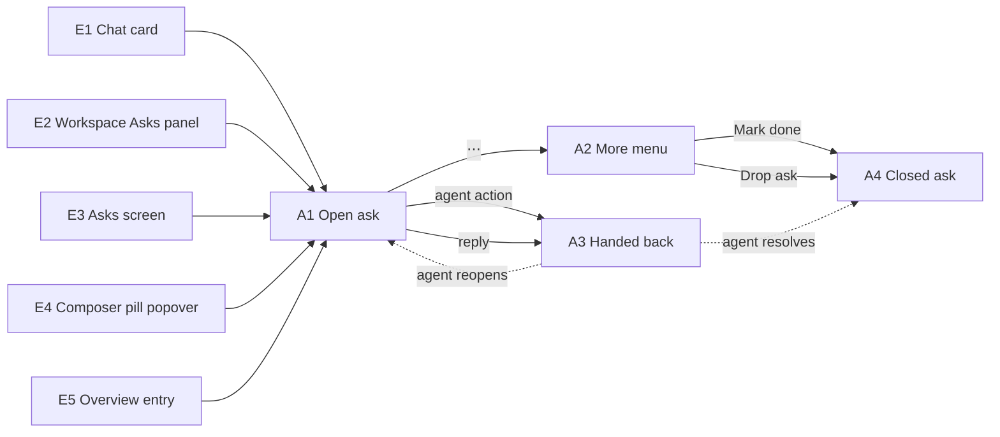

# Simplify the ask card — UI map

Spec: [simplify-ask-card.md](./simplify-ask-card.md). Reviewed at `52e68f5`.

## Navigation

Asks adds no menu group. It shows up in five existing places, each drawing the same card (`AskRow` → `AskDetail` in `client/AsksView.tsx`):

- **Sidebar header**: an *Asks* item with the waiting count opens the all-workspaces Asks screen (`addSidebarHeaderItem`, `addScreen`).
- **Workspace panel**: *Asks* in the main area or the Explorer (`addWorkspacePanel`); ⌘K "Open asks for this workspace".
- **Agent chat**: the `ask_create` / `ask_update` / `ask_resolve` tool row becomes the card (`addTimelineRenderer`).
- **Composer pill**: question-bubble pill with the workspace count; its popover lists the workspace's asks (`addComposerPill`).
- **Overview** (FSH host): one entry per waiting ask in *Your move* (`WorkspaceAskEntry`).

Settings stay under Settings → Plugins → Asks; nothing in this change touches them. Discuss opens an ordinary child agent chat, which is outside this change.

This change redesigns the card's area A once. Area E records how each surface hosts it, so the atlas can show the card at each width.

## Flow

## A — Ask card (the redesign)

- **A1 Open ask** (P1) — the expanded card for an ask waiting on you: header row, PR line and preview chips when it has a PR, the body, the agent's actions with the recommended one primary, a ⋯ button, and a one-line reply field with a send icon. Kinds: PR, decision, follow-up, question with no actions, orphaned. Get here: expand a row on any E view; chat cards of open asks open expanded. Permission: none (whoever has the app).
- **A2 More menu** (P1, menu on A1) — Mark done, Discuss in side chat (or Open discussion), Open chat (hidden in the raising agent's own chat), then Drop ask in the destructive tone. Text typed in the reply field goes along with the chosen item. Get here: ⋯ on A1. Permission: none.
- **A3 Handed back** (P1) — an ask in progress after you acted: header, PR line, the outcome ("You chose QA-approve + merge"), no buttons, no reply field. Get here: any answer on A1 that goes to the agent. Permission: none.
- **A4 Closed ask** (P1) — done or dropped: collapsed row with the status badge; expanded shows the outcome and the body read-only. Get here: Mark done or Drop ask on A2, or the agent resolving. Permission: none.

## E — Existing screens that host the card

- **E1 Chat card** (P1) — the card inline in the agent's chat, actions above the body; earlier calls on the same ask stay folded read-only rows (unchanged). Get here: scroll the agent's chat. Permission: none.
- **E2 Workspace Asks panel** (P1) — the workspace's asks grouped by status, in the main area or the narrow Explorer. Get here: the panel's tab, Explorer + menu, or ⌘K. Permission: none.
- **E3 Asks screen** (P1) — every workspace's asks with the Needs you / In progress / … filters. Get here: Asks in the sidebar header. Permission: none.
- **E4 Composer pill popover** (P1) — this agent's asks first, others with Open chat, plus Refresh asks. Get here: the question-bubble pill in the composer. Permission: none.
- **E5 Overview entry** (P1) — one waiting ask per row in the host's Overview, expandable in place. Get here: Overview, *Your move*. Permission: none.

## Later phases

None planned. Prompt change for action labels (verb + object, no PR number) ships with A1 and has no screen.

## Open questions

1. Should E2–E5 be in the atlas at all, or is A1–A4 at desktop and phone width enough?
