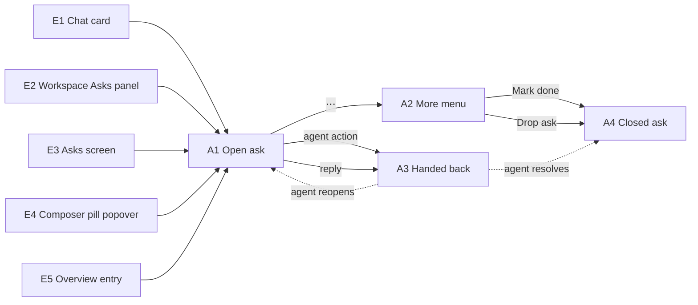

# Simplify the ask card — UI map

Spec: [simplify-ask-card.md](./simplify-ask-card.md). Reviewed at `52e68f5`.

## Navigation

Asks adds no menu group. It shows up in five existing places, each drawing the same card (`AskRow` → `AskDetail` in `client/AsksView.tsx`):

- **Sidebar header**: an *Asks* item with the waiting count opens the all-workspaces Asks screen (`addSidebarHeaderItem`, `addScreen`).
- **Workspace panel**: *Asks* in the main area or the Explorer (`addWorkspacePanel`); ⌘K "Open asks for this workspace".
- **Agent chat**: the `ask_create` / `ask_update` / `ask_resolve` tool row becomes the card (`addTimelineRenderer`).
- **Composer pill**: question-bubble pill with the workspace count; its popover lists the workspace's asks (`addComposerPill`).
- **Overview** (FSH host): one entry per waiting ask in *Your move* (`WorkspaceAskEntry`).

Settings stay under Settings → Plugins → Asks; nothing in this change touches them. Discuss opens an ordinary child agent chat, which is outside this change.

This change redesigns the card's area A once. Area E records how each surface hosts it, so the atlas can show the card at each width.

## Flow

## A — Ask card (the redesign)

Views: A1 Open ask, A2 More menu, A3 Handed back, A4 Closed ask.

## E — Existing screens that host the card (cards only)

Views: E1 Chat card, E2 Workspace Asks panel, E3 Asks screen, E4 Composer pill popover, E5 Overview entry.

## Later phases

None planned. Prompt change for action labels (verb + object, no PR number) ships with A1 and has no screen.

## Decisions (map, 2026-11-23)

1. The atlas draws the card only: A1–A4 at desktop and phone width. E1–E5 get cards with no mockups (A5).
